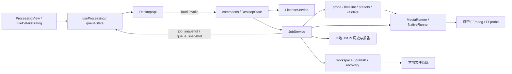

# 帧序 · 架构上下文

> 2026-10-16 核对，功能基线 `e8f5620`，含本轮自定义变化验收修正。这是当前实现的导航与约束，历史计划中的目标不能替代实现证据。
> 2026-10-17 补入工作区的 `reset_item` 契约与身份隔离规则。

## 系统边界



媒体在本地处理；没有业务服务端。许可服务会通过 UDP 查询 NTP 时间，因此“本地处理”不代表应用完全不联网。JS 不直接执行媒体命令或清理文件；原生层负责工具路径、输入身份、任务状态及输出边界。

## 模块职责与入口

| 模块 | 职责 | 主要入口 |
| --- | --- | --- |
| UI | 工作台、文件行、日志与详情对话框 | [ProcessingView.tsx](src/features/processing/ProcessingView.tsx)、[FileDetailsDialog.tsx](src/features/processing/FileDetailsDialog.tsx) |
| 前端状态 | 订阅生命周期、操作互斥、选择身份、快照归并 | [useProcessing.ts](src/features/processing/useProcessing.ts)、[queueState.ts](src/features/processing/queueState.ts) |
| 桌面桥接 | 显式调用契约、系统选择器与拖入监听 | [desktop.ts](src/api/desktop.ts)、[contracts.ts](src/api/contracts.ts) |
| 原生入口 | 注册命令与插件、恢复清理、事件广播、关闭等待 | [main.rs](src-tauri/src/main.rs)、[commands.rs](src-tauri/src/commands.rs) |
| 调度 | 批次冻结、双活动预留、取消、终态与历史 | [service.rs](src-tauri/src/jobs/service.rs)、[state.rs](src-tauri/src/jobs/state.rs) |
| 媒体 | 路径收集、身份、轨道探测、逐帧时间轴、输出校验 | [media](src-tauri/src/media/mod.rs) |
| 预设 | 从输入与请求构建任务内存中的冻结计划 | [basic.rs](src-tauri/src/presets/basic.rs)、[presets](src-tauri/src/presets/mod.rs) |
| 进程 | 固定工具定位、参数数组执行、输出限长、取消与私有脚本 | [native](src-tauri/src/native/mod.rs) |
| 输出 | 工作区归属、排他提交、启动清理 | [output](src-tauri/src/output/mod.rs) |
| 许可 | 本机与 NTP 时间比较、单调时钟推进、开始时检查 | [license.rs](src-tauri/src/license.rs)、[useLicense.ts](src/features/processing/useLicense.ts) |

Rust 核心库默认不启用 `desktop`；Tauri 命令与可执行目标通过 feature 启用。默认 `cargo test` 不等于桌面集成检查，需要额外带 `--features desktop` 的 clippy／构建。

## 契约与任务身份

Rust 数据定义位于 [contracts](src-tauri/src/contracts/mod.rs)，TypeScript 镜像手动维护于 [contracts.ts](src/api/contracts.ts)，没有自动生成步骤。结构字段使用 camelCase；状态和错误码使用 snake_case；请求类型对未知字段有显式拒绝规则。

| 对象 | 身份、寿命与用途 |
| --- | --- |
| `QueueItem` | `itemId` 在导入或成功条目重置时生成；`waiting / started / canceled` 是队列层状态，不是实际任务阶段 |
| `JobSnapshot` | `jobId` 在预留执行时生成；携带实际阶段、进度、错误、结果路径及 `cleanupPending` |
| `QueueSnapshot` | `version` 管结构变化与关联，`running` 来源于是否存在冻结批次设置 |
| `JobSnapshot.version` | 只比较同一 `jobId` 的更新；不能与队列版本或另一个任务的版本比较 |
| `BatchSettings` | 输出目录、预设、元数据及可选公开自定义档位；开始后冻结并用于后续补位任务 |
| `ProcessingPlan` | 完整输入信息、参数、工作区与校验策略；任务内存使用，当前不写入恢复／历史 JSON |
| `FileIdentity` | 规范路径、字节数、修改时间与 SHA256；`modifiedNs` 在 wire 中用字符串表达 |

输出目录是界面偏好，由 `useProcessing` 以 `frameshift.outputDirectory.v1` 键保存到应用 WebView 的 `localStorage`，桌面启动时同步恢复；浏览器预览不恢复桌面偏好。只在有效目录选择回包且仍挂载、未开始批次时保存，取消／迟到回包不覆盖原值。读取失败回到未选择，写入失败保留本次可用值并提示；恢复路径仍经现有原生输出校验，不赋予额外文件权限。

修改 IPC 时同步核对 [job fixture](tests/fixtures/job-snapshot.json)、[queue fixture](tests/fixtures/queue-snapshot.json) 与 [wire_contract.rs](src-tauri/tests/wire_contract.rs)。兼容的 `start_job`、独立探测及最近任务查询入口仍存在，不能只根据 UI 不调用就删除。

## 一次批次如何执行

1. **收集。** `import_folder / import_paths` 在阻塞线程执行轻量路径收集；目录只枚举当前层。规范化路径键去重；Windows 额外处理大小写、分隔符和长路径前缀。完整媒体检查延后到执行，收集回来后再次检查空闲，阻止晚到导入改写已开始批次。
2. **预留。** `start_batch` 在同一状态锁内冻结设置并调用 `reserve_next`；先将活动项和 `jobId` 关联写入，再启动异步执行。最多两个活动任务，旧单任务入口保持独占。
3. **探测。** `probe_input` 计算输入身份，读取媒体 JSON 和完整逐帧时间轴，必要时读音频包补全时长，再复核身份。
4. **准备与转换。** 建立独立工作区，构建计划；从任务 ID 推导的变化参数在本任务内冻结。`MediaRunner` 接收工具枚举及参数数组，不拼接 shell 命令。
5. **校验。** FFmpeg 转码正常退出后，重新探测临时输出、检查规格、完整解码、复核源文件和输出身份。
6. **提交与收尾。** 进入不可取消的 `committing` 后排他保存；完成清理、记录终态和保存历史，再释放活动名额、预留下一个等待项。队列与任务事件在服务锁外发送。

并发上限约束的是任务完整生命周期，不是仅两个 FFmpeg 转码进程。校验、取消收尾及工作区清理结束前都不能提前补位。单项失败仍会收尾并继续调度其他等待项；没有自动重试。相关行为由 [batch_lifecycle.rs](src-tauri/tests/batch_lifecycle.rs) 验证。

`reset_item(itemId)` 在服务同一互斥锁内检查空闲和真实任务成功状态，保持去重键、路径与队列顺序，原位替换为新 `itemId` 的 waiting 项，清除 job／快照／媒体关联并提升队列版本，随后广播快照。原任务终态、报告、历史及输出文件均保留；再次开始使用当前共享设置和新 `jobId`。运行中、失败、取消、等待、未知或过期身份均拒绝重置。

## 状态机、取消与关闭

正常阶段：

```text
probing → preparing → running → validating → committing → succeeded
```

非终态可失败；提交前可进入 `canceling → canceled`。`succeeded / failed / canceled` 为吸收终态，不允许后续进度或事件回退；`committing` 的取消返回真实状态，不能改成已取消。清理失败可与成功结果共存，通过 `cleanupPending` 和报告提示表示，不应隐藏已保存输出。

等待项取消不创建实际任务；活动项取消需等子进程及清理结束。FFmpeg 先通过独立保留的 stdin 收到 `q`，三秒宽限后仍未退出才强制终止；FFprobe 取消直接终止。取消要等待管道读取与子进程退出，不能只改前端状态。

窗口关闭和应用退出都走 `shutdown`：先标记 `closing`、停止调度，取消检查及可取消任务，等待全部活动完成；保存中的任务等待真实提交结果。重入关闭事件通过原生原子标志处理。实现与验证入口：[NativeRunner](src-tauri/src/native/process.rs)、[job_lifecycle.rs](src-tauri/tests/job_lifecycle.rs)、[lifecycle_real.rs](src-tauri/tests/lifecycle_real.rs)。

## 媒体验证不变量

完整标准见 [probe.rs](src-tauri/src/media/probe.rs)、[timeline.rs](src-tauri/src/media/timeline.rs)、[validate.rs](src-tauri/src/media/validate.rs)。修改预设时同样受这些约束：

- 时间轴来自真实帧，不把 `nb_frames` 或容器帧率当作唯一事实。逐帧相对时间戳归一化为有理数秒后计算 SHA256，允许等价时间基；原速对源摘要、变速对统一变换后的摘要，拒绝不符合目标的帧顺序／间隔变化。
- 转码使用 `-fps_mode:v passthrough`；Preserve 的编码时间基为 demux，UniformSpeed 使用精确目标编码时间基／轨道 timescale。完整解码使用 passthrough／demux，防止 VFR 被隐式重采样。末帧时长只能来自帧时长、轨道终点或已确认均匀帧间隔。
- 输出核对 H.264、8 bit 4:2:0、原尺寸、帧数、逐帧时间戳、视频起点和时长；有音轨时核对 AAC / 48 kHz、声道数、已知布局、音频时长和音画相对起点。
- 当前视频时长／起点容差为平均一帧，音频为平均一帧与 50 ms 的较大值；不要通过放宽容差掩盖处理错误。
- 已知颜色标记必须保留；未知保持未知。`yuvj420p` 仅在源和输出均已知为全范围且位深匹配时作为等价输出接受。元数据不全不能写成“颜色已完整保留”。
- `MetadataRequest.preserve` 不是逐字复制全部元数据：保留标题，并在备注中追加处理标识；override 由显式字段决定。当前 UI 发送 preserve，没有元数据编辑面板。
- 输入身份在探测和校验阶段反复比较；输出完整解码前后也核对身份。完整解码和这些检查都通过才允许提交。

## 工作区、持久化与恢复

| 位置 | 当前保存内容与边界 |
| --- | --- |
| 用户输出目录下 `.video-editor-<jobId>/` | `output.mp4`、`.owner.json`，及处理期间短暂存在的 `.v.dat / .a.dat` |
| 用户输出目录下 `<stem>_processed_<jobId>.mp4` | 成功提交的新文件；不作为启动清理目标 |
| Tauri 应用数据目录 `job-records/<jobId>.json` | schema 1 的归属恢复记录、工作区身份、最新快照、清理状态 |
| `job-records/history/<jobId>.json` 与 `latest.json` | 快照、最多 64 KiB 的用户报告、必要校验结果、`reportVersion`；不保存完整计划 |

工作区和最终结果位于同一输出目录下。macOS 用 `renameatx_np(..., RENAME_EXCL)`，Windows 用不带覆盖标志的 `MoveFileExW`；提交前同步媒体文件。其他平台的排他提交未实现，不能据 Rust 核心可编译推断 Linux 交付可用。

清理验证任务 ID、目录名、卷／文件身份和 `.owner.json` 一致，并只删除允许的文件名；拒绝目录符号链接／Windows 重解析点和未知文件。禁止将此逻辑改为 `remove_dir_all` 扫描用户目录。

启动先执行登记工作区恢复清理，再初始化服务、整理可识别的普通历史 JSON，移除旧 `plan` 内容并重建旧版用户报告。无法识别或无权限的记录不能声称已清理。服务只从 `history/latest.json` 恢复最近一个终态；队列、批次设置和待处理项不跨重启恢复，当前也没有断点续跑。成功清理的恢复记录会删除。

## 前端同步与竞态约束

`useProcessing` 先订阅两个快照事件，再查询全量队列，避免查询与订阅间漏更新。未知 `jobId` 的事件暂存于 `pending` 并触发查询，关联到达后按任务版本合并；队列结构采用较新结构版本，不能让较旧全量回包覆盖更新的任务快照。

`queueState.newest` 保护终态与较新任务版本。移除再导入或重置同一路径得到新身份，旧任务事件不得进入新行；重置保留路径对应的选中行，同时清空日志并提升详情请求代次。选中项日志用 `jobId + detailGeneration + epoch` 校验异步响应归属；卸载、切换选择或重置后，旧回包不得替换当前详情。订阅异步完成时若已卸载，仍须立即执行 disposer。

开始与导入另有 ref 锁，防止 React 下一次渲染前的双击。原生 `ensure_idle` 是最终互斥边界，前端 disabled 只是交互反馈。相关测试见 [queueState.test.ts](src/features/processing/queueState.test.ts)、[useProcessing.test.tsx](src/features/processing/useProcessing.test.tsx)。

## 工具、权限与加固边界

开发工具固定为 `src-tauri/binaries/<tool>-<target>[.exe]`；安装后固定在主程序旁。准备脚本根据 [sidecars.lock.json](tools/sidecars.lock.json) 校验来源和哈希；运行时 resolver 检查固定位置存在，不重新下载或回退系统 PATH。不要把准备阶段的 SHA 检查描述成每次执行都有完整防篡改验证。

[桌面 capability](src-tauri/capabilities/default.json) 只开放监听／取消监听事件和文件对话框；结果定位由受状态与路径存在检查的原生命令执行。工具缺失时仍可启动界面，媒体命令返回工具错误；不要为了修复显示问题扩大成通用 shell／文件系统权限。

滤镜表达式经编译时编码、运行时还原，随后写入归属校验后的私有任务脚本；首次正数帧进度后删除。Unix 文件权限为 `0600`，Windows 写入前设置不继承的 Owner Rights DACL；设置失败要失败关闭，不能退回公开明文。计划和完整参数不写入用户报告。详细边界见 [处理加固](docs/processing-hardening.md)：这只能提高分析成本，不能承诺加密保密、不可逆向或安全擦除。

## 设计取舍与后续改动

| 当前取舍 | 维护理由与改动要求 |
| --- | --- |
| 原生层拥有真实状态，UI 合并快照 | 任务持续时间超过一次组件挂载；修改时保留重挂载、乱序事件和双击测试 |
| 固定双活动、开始时冻结设置 | 控制媒体资源占用并隔离条目；扩大并发须复核调度、磁盘竞争、关闭协议与桌面体验 |
| `MediaRunner` 抽象 | 用可控 runner 构造确定性并发／取消测试；真实 runner 的退出和权限仍需原生媒体验证 |
| JSON 历史与归属恢复记录分开 | 用户结果展示与崩溃清理职责不同；变更需考虑旧记录整理，不能重新持久化完整处理计划 |
| 校验后排他提交 | 防止半成品或覆盖既有输出；不可用“文件存在”或退出码代替成功条件 |
| 界面隐藏旧预设，内核保留回归入口 | 用户选择保持简洁，同时守住历史媒体兼容性；删除需要先评估调用与测试依赖 |

以上理由结合代码和既有方案整理，属于维护解释；不追认为当时存在独立 ADR。新增重大选择应在对应计划中记录原因、替代方案及验证结果，并同步本页。

## 自定义变化的设置与时间策略

- [custom.rs](src-tauri/src/contracts/custom.rs) 验证必填的 schema v1 与 14 个整数档位。自定义缺配置、其他模式夹带配置、缺项／未知项／非法值均返回 `invalid_settings`；命令先解码 Value 再进入强类型服务。
- [SettingsStore](src-tauri/src/settings/store.rs) 仅在固定应用数据路径读写公开档位，限长 16 KiB，拒绝链接／重解析目标。异常读取只回退；显式保存使用同目录唯一临时文件、同步和原子替换，成功后才更新内存。默认服务构造使用内存存储，测试不会读写真实应用配置。
- `Inner` 的同一互斥锁串行处理空闲检查、保存、开始校验与批次预留。`reserve_next` 从已冻结 BatchSettings 复制档位；队列的 `activeSettings` 随结构版本表示实际批次，结束后省略。磁盘后续变化不会影响补位。
- [自定义预设](src-tauri/src/presets/custom/mod.rs) 为每个效果从任务 ID 和独立效果键推导随机流。只有公开档位可序列化；固定数值仅存在内存。布局、画面、声音与编码按固定顺序构建，新模板仍经 opaque 编码和原生私有脚本传递。
- [TimingPolicy](src-tauri/src/contracts/timing.rs) 区分 Preserve／UniformSpeed；[timing.rs](src-tauri/src/media/timing.rs) 用有理数统一变换视频和音频，保护 timescale、乘法及 FFmpeg 表达式整数精度。变速验证重新流式扫描受身份保护的源帧，不能缩放旧哈希。
- 视频目标摘要精确匹配，帧数不变；末帧封装时长仍受目标平均一帧容差约束。变速平均帧率须与解码帧数／有效时长的有理数严格一致。音频另校验目标有效 48 kHz 采样数（至多一采样误差）；仅识别与目标起点相差精确 1024 采样的 AAC 前导编码延迟，不借 50 ms 封装容差接受尾部缺失。
- 自定义声音使用逐声道 Rubber Band（锁定的两平台工具已有该功能）独立处理速度与音高；长窗口、质量模式及平滑瞬态由 LFE 音调／尾部验收校准。只允许有界 `pad_len=1024` 后裁齐目标；旧六套预设滤镜保持不变。

前端 [useCustomSettings](src/features/processing/useCustomSettings.ts) 分离保存值与草稿，使用同步 ref 锁和挂载／请求代次保护迟到回包。开始读取最新编辑锁，模式恢复依据 `activeSettings`；旧／未知运行模式显示冻结状态，不以记忆设置猜测。
